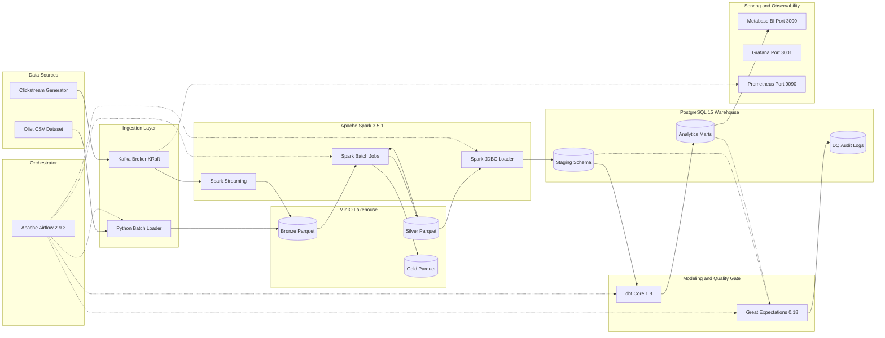

# E-Commerce Analytics Platform
### End-to-End Modern Data Engineering Platform (Batch + Streaming Lakehouse Architecture)

[](https://github.com/your-username/ecommerce/actions/workflows/ci.yml)


---

## Gambaran Umum Proyek

Proyek ini merupakan implementasi Platform Data Engineering tingkat produksi untuk industri e-commerce. Sistem ini mengintegrasikan pemrosesan data historis transaksi (Batch) dan data perilaku pengunjung waktu nyata (Streaming) menggunakan arsitektur Medallion Lakehouse, orkestrasi otomatis, penjaminan mutu data berlapis, dan observabilitas infrastruktur secara menyeluruh. Seluruh sistem dirancang untuk berjalan secara mandiri (on-premise / self-hosted) menggunakan Docker Compose tanpa ketergantungan pada penyedia cloud publik berbayar.

Dataset transaksi historis mengadopsi Brazilian E-Commerce Public Dataset by Olist (~100.000 transaksi pesanan), yang diperkaya dengan generator sintetis streaming clickstream pengguna.

---

## Arsitektur Sistem

Diagram berikut mengilustrasikan aliran data hulu-ke-hilir, keterhubungan komputasi, orkestrasi, dan pemantauan sistem:



<details>
<summary>Lihat Representasi Teks Alternatif (ASCII Architecture Diagram)</summary>

```
+---------------------------------------------------------------------------------------------------------+
|                                    PLATFORM DATA ENGINEERING END-TO-END                                 |
|                                                                                                         |
|  [DATA SOURCES]                     [STREAMING & STORAGE]               [PROCESSING & LAKEHOUSE]        |
|  - CSV Data (Olist Dataset) ------> MinIO S3 (Bronze Raw) ------------> Apache Spark (Batch)            |
|  - Clickstream Producer ----------> Apache Kafka (KRaft Broker) ------> Apache Spark (Streaming)        |
|                                                                                |                        |
|                                                                                v                        |
|                                                                        [MinIO Lakehouse]                |
|                                                                        - Bronze (Raw Parquet)           |
|                                                                        - Silver (Cleaned / Dedup)       |
|                                                                        - Gold (Business Aggregations)   |
|                                                                                |                        |
|  [SERVING & PRESENTATION]           [DATA WAREHOUSE & QUALITY]                 v                        |
|  - Metabase BI (Port 3000) <------- PostgreSQL Warehouse (Port 5433) <--- Spark JDBC Load              |
|  - Grafana Observability (3001)     - Schema: staging                          |                        |
|  - Prometheus Metrics (9090)        - Schema: analytics (dbt Dimensional Marts)|                        |
|                                     - Schema: dq_logs (Great Expectations) <---┘                        |
|                                                                                                         |
|  [ORCHESTRATION & AUTOMATION]                                                                           |
|  - Apache Airflow (Port 8080): Mengorkestrasi ELT Batch, Monitoring Streaming, & Data Quality Gate      |
|  - CI Pipeline (GitHub Actions): Otomatisasi Linting (Flake8) & Testing (Pytest, PySpark, Airflow DAGs)  |
+---------------------------------------------------------------------------------------------------------+
```

</details>

---

## Fitur dan Komponen Utama

### 1. Ingestion Layer
- **Batch Loader (`ingestion/batch_loader.py`)**: Sanitasi file mentah, verifikasi integritas checksum dan skema CSV, serta pemuatan terenkapsulasi ke MinIO S3 bucket `datalake/bronze/olist/`.
- **Event Streaming Producer (`ingestion/clickstream_producer.py`)**: Generator streaming berbasis Kafka producer yang menghasilkan transaksi event pengguna (`page_view`, `add_to_cart`, `purchase`) dengan pembobotan statistik yang realistis.

### 2. Medallion Lakehouse Processing (Apache Spark 3.5.1)
- **Streaming Ingestion (`kafka_to_bronze.py`)**: Mengonsumsi pesan Kafka secara berkesinambungan menggunakan Spark Structured Streaming dengan checkpoint toleran kesalahan, disimpan dalam format partisi Parquet di Bronze Lakehouse.
- **Bronze to Silver (`bronze_to_silver.py`)**: Pembersihan data, penanganan inkonsistensi tipe data timestamp, eliminasi anomali finansial (harga/ongkir negatif), dan deduplikasi record berdasarkan primary key.
- **Silver to Gold (`silver_to_gold.py`)**: Agregasi performa produk dan metrik bisnis tingkat tinggi untuk mempercepat proses query analitik.
- **Load to Warehouse (`load_to_warehouse.py`)**: Transfer data terstruktur dari layer Silver ke schema `staging` PostgreSQL menggunakan Spark JDBC dengan mekanisme truncate-load yang aman.

### 3. Data Warehouse Modeling (dbt-core 1.8)
- Implementasi Star Schema (Kimball methodology) di schema `analytics`:
  - **Tabel Dimensi**: `dim_customers`, `dim_products`, `dim_date`.
  - **Tabel Fakta**: `fact_orders` (transaksi pesanan historis) dan `fact_events` (aktivitas streaming near real-time).
- **Data Testing Otomatis**: 21 pengujian integritas struktural (`unique`, `not_null`, `relationships`, dan `accepted_values`).

### 4. Orkestrasi Terjadwal (Apache Airflow 2.9.3)
- **`batch_elt_pipeline`**: DAG utama yang mengeksekusi pipeline batch secara deterministik: Ingestion -> Spark Transformations -> DWH Loading -> dbt Transformation -> Data Quality Trigger.
- **`dq_checkpoint_pipeline`**: DAG khusus validasi kualitas data pasca-eksekusi pipeline.
- **`streaming_monitor`**: DAG liveness check pemantau kestabilan broker Kafka dan consumer group.

### 5. Data Quality Gate (Great Expectations 0.18)
- Validasi data mentah Bronze (`bronze_orders_suite`) dan aturan validitas bisnis Silver (`silver_orders_suite`).
- Pencatatan otomatis riwayat hasil validasi ke tabel audit `dq_logs.checkpoint_runs`.
- Pembuatan dokumentasi visual interaktif Data Docs HTML untuk penelusuran kualitas data historis.

### 6. Piramida Pengujian Empat Lapisan (Four Layers of Testing)
- **Lapisan 1 (Unit Test)**: Mocking dan validasi modul ingestion (`tests/test_batch_loader.py`, `tests/test_clickstream_producer.py`).
- **Lapisan 2 (Transformasi Spark)**: Pengujian logika manipulasi PySpark menggunakan SparkSession lokal (`spark_jobs/tests/test_transformations.py`).
- **Lapisan 3 (DAG Integrity)**: Verifikasi sintaksis, deteksi import cycle, dan kepatuhan metadata DAG Airflow (`tests/test_dag_integrity.py`).
- **Lapisan 4 (Data Testing)**: 21 dbt tests dan 8 Great Expectations validation checks (Total: 44/44 Test Passed).

### 7. Serving Layer dan Observabilitas
- **Metabase BI (Port 3000)**: Dashboard `E-Commerce Operations Overview` yang menampilkan Gross Merchandise Value (GMV), Average Order Value (AOV), volume transaksi bulanan, kategori produk unggulan, dan pantauan aktivitas sesi live streaming.
- **Prometheus (Port 9090) & Grafana (Port 3001)**: Pengumpulan metrik otomatis melalui Exporters (Kafka message rate, consumer lag, koneksi aktif PostgreSQL, dan kegagalan task Airflow) dengan konfigurasi auto-provisioning.

---

## Panduan Menjalankan Platform (Quickstart)

### Prasyarat Sistem
- **Docker Desktop** (Alokasi RAM minimal 8 GB, disarankan 12 GB - 16 GB).
- **Git** & **PowerShell** (Windows) atau **Bash / Make** (Linux / macOS).

### 1. Kloning Repositori dan Persiapan Environment
```bash
git clone https://github.com/your-username/ecommerce.git
cd ecommerce
cp .env.example .env
```

### 2. Menjalankan Seluruh Stack
Gunakan skrip otomasi sesuai sistem operasi Anda:

**Lingkungan Windows (PowerShell):**
```powershell
.\manage.ps1 up
```

**Lingkungan Linux / macOS / Git Bash:**
```bash
make up
```

### 3. Pemeriksaan Kesehatan Layanan (Healthcheck)
Pastikan seluruh service telah siap menerima koneksi:
```powershell
.\manage.ps1 health
```

### 4. Eksekusi Pipeline End-to-End
Pipeline dapat dijalankan secara otomatis melalui Web UI Airflow (`http://localhost:8080`) dengan memicu DAG `batch_elt_pipeline`, atau dieksekusi secara bertahap via terminal:
```powershell
.\manage.ps1 load-raw        # Pemuatan data mentah CSV ke MinIO Bronze
.\manage.ps1 spark-batch      # Transformasi Spark: Bronze -> Silver -> Gold -> DWH
.\manage.ps1 dbt-run          # Eksekusi dbt Dimensional Modeling & Testing
.\manage.ps1 dq-check         # Pengujian kualitas data Great Expectations
```

### 5. Menjalankan Seluruh Test Suite
```powershell
.\manage.ps1 test
```

---

## Katalog Port dan URL Dasbor

| Layanan | URL Web / Port | Kredensial Default | Deskripsi Fungsional |
|---|---|---|---|
| **Airflow Web UI** | `http://localhost:8080` | `admin` / `admin123` | Antarmuka orkestrasi dan penjadwalan DAG |
| **Spark Master UI**| `http://localhost:8081` | *(Tanpa autentikasi)* | Monitoring alokasi resource cluster Spark |
| **MinIO Console**  | `http://localhost:9001` | `minioadmin` / `minioadmin123` | File browser objek data lakehouse S3 |
| **Metabase BI**    | `http://localhost:3000` | Dikonfigurasi saat setup awal | Dashboard analitik bisnis dan visualisasi |
| **Grafana**        | `http://localhost:3001` | `admin` / `admin123` | Dashboard pemantauan infrastruktur data |
| **Prometheus**     | `http://localhost:9090` | *(Tanpa autentikasi)* | Mesin metrik time-series & query PromQL |
| **PostgreSQL DWH** | `localhost:5433` | `dwh_user` / `dwh_pass123` | Data Warehouse relasional (Port host 5433) |
| **Kafka Broker**   | `localhost:9094` | *(Plaintext)* | Port broker eksternal untuk streaming |

---

## Struktur Direktori Proyek

```
ecommerce/
├── .github/
│   └── workflows/
│       └── ci.yml                 # Pipeline CI (Flake8 linting & Pytest execution)
├── airflow/
│   └── dags/                      # Definisi DAG Airflow (batch, streaming, dq)
├── data/
│   └── raw/olist/                 # Direktori penyimpanan dataset CSV mentah
├── dbt/
│   └── ecommerce_dwh/             # Proyek dbt (model staging & analytics marts)
├── docker/
│   └── spark/                     # Dockerfile kustom Spark (konektor S3A & PostgreSQL)
├── docker-compose.yml             # Konfigurasi orkestrasi 16 container service
├── great_expectations/            # Konfigurasi suite, stores, & checkpoints GX
├── ingestion/                     # Skrip batch loader & producer event streaming
├── monitoring/
│   ├── prometheus/                # Konfigurasi target scraping & alert rules
│   └── grafana/                   # Konfigurasi auto-provisioning datasource & dashboard
├── spark_jobs/
│   ├── batch/                     # Skrip pemrosesan PySpark batch layer
│   ├── streaming/                 # Skrip PySpark Structured Streaming consumer
│   └── tests/                     # Pengujian transformasi PySpark
├── tests/                         # Unit tests ingestion, producer, & DAG integrity
├── Makefile                       # Otomatisasi perintah command line (Unix)
├── manage.ps1                     # Otomatisasi perintah command line (Windows PowerShell)
├── .gitignore                     # Aturan pengecualian file rahasia, cache, & dataset
└── README.md                      # Dokumentasi teknis proyek
```

---

## Prosedur Menghentikan Platform

Untuk menghentikan seluruh container dengan tetap mempertahankan data pada volume:
```powershell
.\manage.ps1 down
```

Untuk menghentikan container dan menghapus seluruh volume data (Reset Total):
```powershell
.\manage.ps1 destroy
```

---

## Lisensi dan Kontribusi
Proyek ini dikembangkan untuk tujuan portofolio profesional rekayasa data (*Data Engineering Portfolio*). Seluruh kode dirancang menggunakan lisensi open-source dan mengikuti standar praktik terbaik industri perangkat lunak dan arsitektur data modern.
